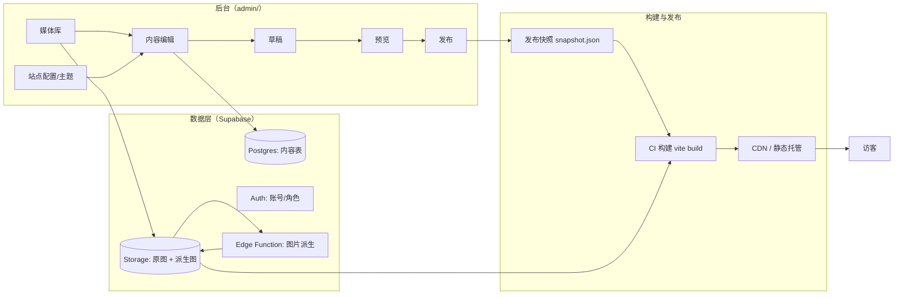
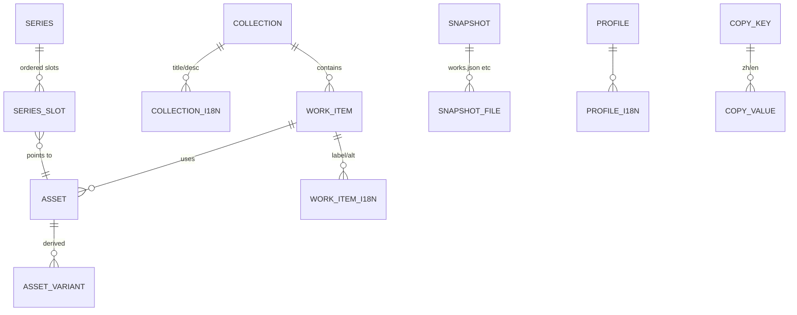
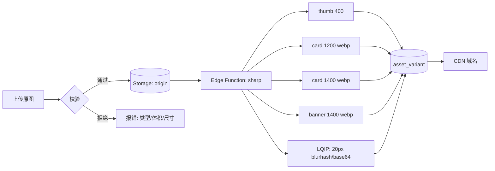

# 作品集后台管理系统 · 策划方案

> 版本：v1.0 · 2026-11-03
> 适用站点：`E:\design-portfolio`（Witt He 个人设计作品集，Vite + React 19 + TS + Tailwind 4 单页站）
> 本文只做策划，不含实现代码。

---

## 0. 一页速览

| 项 | 结论 |
|---|---|
| 系统定位 | **不是通用 CMS**，而是"为这一个站点量身定做的内容工作台"：内容模型直接对齐现有 `works.json` / `profile.ts` / `i18n` 三套契约 |
| 核心价值 | 把"改内容 = 改代码 + 跑脚本 + 重新部署"这条链路，换成"后台点几下 → 预览 → 发布" |
| 形态 | 独立后台应用（`admin/`）+ 托管数据库 / 对象存储；前台仍是纯静态 Vite 站点，构建时吃 CMS 快照 |
| 主推技术 | 后台 Vite + React + TS + Tailwind；数据 Supabase（Postgres + Storage + Auth + RLS）；图片派生用 sharp / Edge Function |
| 内容规模 | 139 件作品 / 21 张 VI / 20 张海报 / 5 组图标 / 5 套商品套图（28+30 张）/ 15 张营销海报 / 5 组溶图 / 10 张 Banner；120+ 条双语词条 |
| 高度定制化落点 | 每种作品类型一套独立字段组与校验（如商品套图的 6 类语义标签、Banner 的 3.2:1 硬校验、VI 的 7 张九宫格顺序）+ 可编辑的设计 token + 可开关的动效档位 |
| 交付形态 | 静态站零改动接入；构建时拉快照，失败自动回退到仓库内 `works.json` |
| 上线后 | 见第 14 章：日常 SOP、五个典型场景剧本、FAQ 与排障 |

**一句话**：让设计师自己维护内容，让"发布"变成一个有预览、有校验、可回滚的动作，而不是一次代码提交。

---

## 1. 为什么不能用通用 CMS

先明确不能用现成方案的原因，后面的设计才有依据。

| 通用 CMS 的做法 | 本站的实际约束 | 冲突后果 |
|---|---|---|
| 一个"文章"表 + 自定义字段 | 六类作品结构完全不同（单图 / 有序图组 / 图组+详情页 / 前后对比对 / 套装 / 展板） | 要么强行塞进同一张表（字段全是可空），要么写一堆 if |
| 富文本编辑器 | 页面文案是**成对的中英词条**，且 `en` 受 `Dict` 类型约束，缺键直接编译报错 | 富文本产出 HTML，无法保证双语完整与类型安全 |
| 图片随便传 | 前端按 `w/h` 预留 `aspect-ratio` 防跳动；海报要 1200 长边 webp 副本进 GPU；Banner 单张原图 5.8 MB | 尺寸未知 → 布局抖动；原图直传 → 首屏被拖垮 |
| 分类 = 自由标签 | 分类直接对应页面区块与渲染组件（VI 九宫格、溶图拖动对比、Banner 纵深卡组） | 标签错了 → 组件不渲染或渲染错 |
| 排序 = 按发布时间 | 作品顺序是**叙事顺序**（商品套图必须"首图→场景卖点→…→白底图"） | 顺序乱 → 信息层级崩掉 |
| 发布 = 立即生效 | 需要"草稿 → 预览 → 发布 → 可回滚"，且发布要触发静态站重建 | 改错无法回退，改完线上没变化 |

结论：**内容结构必须先建模，再谈后台界面**。本站的模型已经被前端契约固化了，后台要做的就是"把这个契约变成可编辑的表单"。

---

## 2. 现状盘点：内容到底存在哪

| 内容 | 现在的存放位置 | 生成方式 | 谁在消费 |
|---|---|---|---|
| 作品清单 | `src/data/works.json` | `scripts/sync-assets.mjs` 扫描 `E:\作品集` 生成 | `GraphicSection` / `CommerceSection` / `Hero` 统计 |
| 作品图片 | `public/works/**`（原图）+ `public/preview/**`（webp 副本） | 同上，`emitCard()` 生成 1200/1400 长边副本 | `LazyImage` / `FlexCarousel` 纹理 / 九宫格 |
| 个人信息 | `src/data/profile.ts`（`as const`） | 手改 | Header / Hero / About / Outro / 简历弹窗 |
| 简历 | `public/profile/resume.jpg` + `src/data/resume.ts` | 手换图片；结构化数组目前为空 | `ResumeDialog` |
| 双语文案 | `src/i18n/zh.ts` + `en.ts`（`en: Dict` 强约束） | 手改 | 全站 |
| 设计 token | `src/index.css` 的 `@theme` 块 | 手改 | 全站颜色/字体/间距 |
| 动效开关 | 各组件 props + `usePerfTier` / `prefers-reduced-motion` | 手改 | 全站动效 |
| 跑马灯文案 | `CommerceSection` 顶部常量 | 手改 | 尾随跑马灯 |

**关键观察**：除简历图外，所有内容最终都收敛成"两份 TS/JSON + 一批图片"。这就是 CMS 需要写回的目标形态。

---

## 3. 系统总览

### 3.1 架构



### 3.2 三条边界

1. **后台只产出数据，不产出 HTML**：前台渲染逻辑（九宫格、透镜轮播、拖动对比）仍然写死在代码里，后台只能控制"喂给它的数据"和"开关/文案"。这是保证视觉不崩的前提。
2. **前台永远可离线构建**：仓库里始终保留一份可用的 `works.json` / 默认文案，CMS 挂了也能出包。
3. **发布 = 生成不可变快照 + 触发一次构建**，不做实时数据库直连（静态站没有运行时后端，也不该有）。

### 3.3 角色

| 角色 | 能做什么 | 说明 |
|---|---|---|
| Owner（你） | 全部权限，含发布、回滚、成员管理、危险操作 | 默认只有 1 个 |
| Editor | 编辑内容、上传素材、提交"待发布"，不能发布/回滚 | 未来接外包协作时用 |
| Viewer | 只读 + 可评论 | 可选，给客户看稿 |

单人使用可以只开 Owner 一个账号，但权限模型先留好，不然后面加人要把表全改一遍。

---

## 4. 技术选型

### 4.1 三个候选

| 方案 | 组成 | 优点 | 缺点 | 结论 |
|---|---|---|---|---|
| **A. 纯自建** | Fastify + Postgres + S3 + 自写鉴权 | 完全可控 | 鉴权/上传/RLS/备份全自己写，工期 ×2 | 不推荐（个人站） |
| **B. Supabase + 自建 Admin 前端** | Postgres + Storage + Auth + RLS + Edge Function；前端 Vite + React + TS | 与现有技术栈同源；鉴权与存储开箱即用；本地可 `supabase start` 跑全套；SQL 直连便于迁移 | 依赖第三方（可自托管） | **主推** |
| **C. Next.js + 现成 CMS（Payload/Directus/Strapi）** | Headless CMS 全家桶 | 后台界面白送 | 仍要写大量自定义字段与校验才能贴合本站；主题/双语/图片派生还是要自己写；多一层运行时 | 备选（想省前端工时可选 Payload） |

### 4.2 主推组合

```
admin/                 # 与站点同仓，独立 Vite 应用，端口 5174
  src/
    app/               # 路由（react-router）
    features/          # works / media / copy / profile / theme / publish / settings
    components/        # 字段组件库（见 7.2）
    lib/               # supabase client / 校验 / 排序 / 图片工具
supabase/
  migrations/          # SQL 迁移（表、RLS、触发器）
  functions/derive/    # 图片派生（sharp）
public-site/           # 现有站点（不变）
```

- **后台 UI**：React 19 + TS + Tailwind 4 + `react-router`；表单用受控组件自写（字段组件化后比引入表单库更省）；拖拽用 `@dnd-kit/core`。
- **鉴权**：Supabase Auth（邮箱 + 密码 / 魔法链接），单账号开启 2FA（TOTP）。
- **存储**：Supabase Storage，bucket 分 `origin`（原图）与 `derived`（派生图），前者私有、后者公开只读走 CDN。
- **图片派生**：Edge Function 内用 sharp（或在 CI 上用 Node 20 + sharp，与现有 `sync-assets.mjs` 复用逻辑）。
- **预览**：静态站支持 `?preview=<token>`，构建一个独立的 Preview 部署（或本地 dev server + 快照注入）。

---

## 5. 数据模型

### 5.1 关系图



### 5.2 表设计

> 命名统一 `snake_case`；所有表带 `created_at / updated_at / updated_by`；软删除用 `deleted_at`。

#### `collection` 作品分类（固定 8 条，不做增删）

| 字段 | 类型 | 说明 |
|---|---|---|
| key | text PK | `vi` / `poster` / `icon` / `product` / `campaign` / `composite` / `banner`；`vi/product/campaign/composite` 是"套装型"，其余是"平铺型" |
| kind | text | `flat` \| `series` \| `pair` |
| layout | text | `nine-grid` \| `carousel` \| `circular` \| `depth` \| `grid` \| `compare` |
| enabled | bool | 关闭后该区块整段不渲染 |
| sort | int | 区块顺序（当前固定，预留可调） |
| schema | jsonb | 该分类的字段组定义（见 6.3），后台据此渲染表单 |

#### `work_item` 作品条目（平铺型：海报/图标/Banner）

| 字段 | 类型 | 约束 |
|---|---|---|
| id | uuid PK | |
| collection_key | text FK | |
| asset_id | uuid FK → asset | 必填 |
| sort | int | 同 collection 内唯一序（0 起） |
| featured | bool | 是否进首屏统计（默认 true） |
| visible | bool | 下架不删 |
| meta | jsonb | 分类专属字段（如 banner 的 `slot`、poster 的 `style_key`） |

#### `series` 套装（VI / 商品套图 / 营销组 / 溶图组）

| 字段 | 类型 | 说明 |
|---|---|---|
| id | uuid PK | |
| collection_key | text | |
| slug | text unique | 例 `cashmere-throw`，对应现有 id 前缀 |
| sort | int | 套装顺序 |
| cover_asset_id | uuid | 商品套图的 `cover` |
| visible | bool | |

#### `series_i18n` / `series_slot`

| 表 | 字段 | 说明 |
|---|---|---|
| series_i18n | series_id, locale, title | 套装名（中/英各一行） |
| series_slot | id, series_id, role, asset_id, sort, label_zh, label_en | `role` 语义：`image` / `shot` / `detail` / `scene` / `blend`；`label` 就是现在 `WorkImage.label` 的语义标签（首图/场景卖点/…） |

> 用"通用 slot + role"而不是给每类作品建一张表：新增作品类型时不用改表结构，只改 `collection.schema`。

#### `asset` / `asset_variant` 媒体

| 表 | 字段 | 说明 |
|---|---|---|
| asset | id, storage_key, mime, size, width, height, sha256, lqip, uploaded_by, created_at | `width/height` 上传时即读，用于前端预留比例 |
| asset_variant | asset_id, kind, storage_key, width, height, bytes | `kind`: `thumb400` / `card1200` / `card1400` / `webp_q82` / `avif` |
| asset_usage | asset_id, ref_table, ref_id | 反向引用计数，删除前检查"是否被引用" |

#### `profile` / `profile_i18n`

单行表（`id = 'default'`），字段对齐现有 `profile.ts`：`name_zh/name_en/name_both`、`role`、`city`、`email`、`wechat`、`photo_asset_id`、`since`、`hero_welcome`、`hero_title`、`hero_subtitle`、`socials(jsonb)`。

#### `copy_key` / `copy_value` 文案词典

| 表 | 字段 | 说明 |
|---|---|---|
| copy_key | key text PK（`graphic.vi.desc` 形式）, group, note | `group` 用于后台分组（nav/hero/about/graphic/commerce/outro/footer/…） |
| copy_value | key, locale, value, status(`draft`/`reviewed`), updated_at | 双语分列，缺失即高亮 |

> 这样 120+ 条词条全部可编辑，且能直接导出成 `zh.ts` / `en.ts` 的结构。

#### `site_config` / `theme_token`

| 表 | 字段 | 说明 |
|---|---|---|
| site_config | key, value(jsonb) | 动效档位、跑马灯文案、SEO、统计脚本、维护模式 |
| theme_token | name, value, scope | 对应 `@theme` 里的 `--color-acid` / `--font-display` / `--ease-out` 等 |

#### `revision` / `snapshot` / `publish_job`

| 表 | 字段 | 说明 |
|---|---|---|
| revision | id, entity, entity_id, patch(jsonb), actor, created_at | 每次保存写一条，支持"查看历史/回滚单条" |
| snapshot | id, version(semver), payload_ref, created_at, created_by, note | 发布时把全部内容序列化成一份不可变 JSON |
| publish_job | id, snapshot_id, status(`queued/build/deploy/failed`), log, started_at, finished_at | 构建与部署的流水 |

### 5.3 关键约束（写在数据库里，而不是靠自觉）

```sql
-- 同一分类内 sort 唯一（用可延迟唯一索引，拖拽时先整体平移再落库）
create unique index work_sort_uniq on work_item(collection_key, sort) where deleted_at is null;

-- 双语标题必填
alter table series_i18n add constraint title_not_blank check (length(btrim(title)) > 0);

-- 比例类约束用触发器：Banner 必须 3.2:1（±2%），否则前端会裁切
create or replace function check_banner_ratio() returns trigger as $$
declare a record;
begin
  if new.role = 'banner' then
    select width, height into a from asset where id = new.asset_id;
    if abs((a.width::numeric / a.height) - 3.2) > 0.064 then
      raise exception 'banner 比例必须是 3.2:1（当前 % x %）', a.width, a.height;
    end if;
  end if;
  return new;
end $$ language plpgsql;
```

> 比例类约束用触发器（`before insert/update` 读 `asset.width/height` 判断），比 check 约束可读。

---

## 6. 内容模型 ↔ 前端契约

这一章是"定制化"的核心：后台表单必须和前端渲染一一对应。

### 6.1 六类作品的字段组

| 分类 | 前端组件 | 必填字段 | 数量约束 | 专属校验 |
|---|---|---|---|---|
| 品牌 VI | `ViGrid`（3×3 九宫格） | 套装名（双语）、7 张图、每张的语义名（Logo / Logo 释义 / 色彩与字体规范 / 包装 / 袋装 / 名片 / 网页） | 固定 7 张 | 第 1 张自动跨 2 列、第 3 张跨 2 行，**顺序即版式**，后台必须能拖拽且锁定 7 格 |
| 艺术海报 | `FlexCarousel`（透镜轮播） | 20 张 + 名称（"风格·名称"） | 建议 20，可增减 | 名称含 `·` 时自动拆主副标题；比例 9:16 最佳；生成 1200 长边 webp 供 GPU |
| Icon 图标 | `ScrollStack`（叠放） | 5 张 16:9 展板 + 名称 | 5 | 比例必须 16:9，否则 `object-contain` 出现黑边 |
| 商品套图 | `Gallery` × 2（套图 / 详情页） | 套装名、套图 5–6 张（带语义标签）、详情页 6 张 | 套图 5–6，详情 6 | **语义标签顺序固定**：首图 → 场景卖点 → 细节材质 → 尺寸规格 → 香调规格 → 礼盒信任 → 白底图；详情页与套图共用一个 Lightbox 组，索引偏移由前端算，后台只需保证同套内唯一 |
| 营销海报 | `CircularGallery`（弧形画廊） | 15 张（3 组 × 5） | 3 组 | 不再分品类展示，组只用于后台筛选；9:16 |
| 产品溶图 | `BeforeAfter`（拖动对比） | 每套 scene + blend **成对** | 5 组 | 两张必须同尺寸同构图，否则拖动错位 |
| 电商 Banner | `DepthCarousel`（纵深卡组） | 10 张 | 10 | 3.2:1（3584×1120 或等比），生成 1400 长边副本 |

### 6.2 名称与语义的约定（后台要"帮你填对"）

- **海报名**：`风格·名称`（如 `Y2K·金属梦境`）。后台提供一个"风格"下拉 + "名称"输入，保存时自动拼成 `风格·名称`，避免手打分隔符出错。
- **商品套图标签**：后台不是让用户自由输入，而是**从固定枚举里选**（首图/场景卖点/细节材质/尺寸规格/香调规格/礼盒信任/白底图），选中后自动按既定权重排序，并禁止重复。
- **Banner 名**：`Banner 01…` 由序号自动生成，不手输。
- **英文名**：中文名可留空英文（回退到中文），但**必须给出 `alt` 的双语**（无障碍硬要求）。

### 6.3 `collection.schema` 示例（后台表单即由此渲染）

```json
{
  "vi": {
    "groups": [
      { "key": "title", "type": "i18n-text", "required": true, "label": "套装名" },
      { "key": "plates", "type": "ordered-images", "required": true, "min": 7, "max": 7,
        "slots": ["Logo", "Logo 释义", "色彩与字体规范", "包装设计", "袋装设计", "名片设计", "网页设计"] }
    ]
  },
  "product": {
    "groups": [
      { "key": "title", "type": "i18n-text", "required": true },
      { "key": "shots", "type": "tagged-images", "required": true, "min": 5, "max": 7,
        "tags": ["首图", "场景卖点", "细节材质", "尺寸规格", "香调规格", "礼盒信任", "白底图"] },
      { "key": "details", "type": "ordered-images", "min": 6, "max": 8 }
    ]
  }
}
```

---

## 7. 后台功能地图

### 7.1 页面清单

| # | 页面 | 里面有什么 | 定制点 |
|---|---|---|---|
| 1 | **仪表盘** | 内容健康度（缺 alt / 缺译 / 超大图 / 比例不符）、最近修改、待发布变更数、线上版本 | 健康度规则见 9.5 |
| 2 | **作品 · 列表** | 按 8 个分类分栏；每行缩略图 + 名称 + 数量 + 可见开关 + 拖拽手柄 | 列表密度可切（紧凑/舒适） |
| 3 | **作品 · 编辑器** | 左：字段表单；中：实时预览；右：发布信息/历史 | 预览按分类渲染对应组件（九宫格/轮播/对比） |
| 4 | **媒体库** | 网格 + 筛选（类型/未被引用/超大）；拖拽上传、粘贴上传、批量改名、批量转 webp | 上传即出派生图与 LQIP |
| 5 | **文案词典** | 120+ 条按 group 分组；中英并排编辑；缺失高亮；支持"从英文补中文" | 直接导出 `zh.ts`/`en.ts` 结构 |
| 6 | **个人信息** | profile 全字段；社交链接可增删排序 | 首屏文案与 TechText 的换行预览 |
| 7 | **简历** | 上传/替换简历图；可选启用结构化经历（`resume.ts` 的数组） | 图片模式与结构化模式二选一 |
| 8 | **站点配置** | 动效档位（full/lite 默认值）、模块开关、跑马灯两行文案、SEO、统计代码、维护模式 | 跑马灯文案固定中英两组 |
| 9 | **主题 token** | `@theme` 里的颜色/字体/间距/缓动；改完实时预览 | 改色会同时影响 8 个组件，需要"对比度检查" |
| 10 | **发布中心** | 变更 diff、健康检查结果、发布备注、版本列表、一键回滚 | 见第 10 章 |
| 11 | **设置** | 账号、2FA、成员与角色、API Key、审计日志 | |

### 7.2 字段组件库（后台复用件）

| 组件 | 用途 | 细节 |
|---|---|---|
| `i18n-text` | 双语单行/多行 | 中英并排；英文下方显示字符数建议；支持"同中文"快捷填充 |
| `ordered-images` | 有序图组 | 拖拽排序；每格显示序号 + 比例警告；支持整组替换 |
| `tagged-images` | 带语义标签的图组 | 每张图挂一个枚举标签；标签重复立即报错；自动按权重排序 |
| `pair-images` | 前后对比 | 强制成对；提示"请确保两张同构图" |
| `asset-picker` | 选图 | 从媒体库选/新上传；显示尺寸、体积、引用次数 |
| `enum-select` | 固定枚举 | 用于海报风格、Banner 槽位 |
| `color-token` | 颜色 | 取色器 + hex + 对比度提示 |
| `toggle-group` | 开关组 | 模块显示/动效开关 |
| `sortable-list` | 套装排序 | 拖拽即写 `sort`，批量平移 |

### 7.3 编辑体验（决定"愿不愿意用"）

- **三栏布局**：左导航 + 中列表 + 右编辑器；`Cmd/Ctrl + K` 命令面板（跳转任意作品/动作）。
- **自动保存草稿**：输入停顿 800ms 存草稿，不产生线上影响；顶部常驻"未发布的 N 处修改"。
- **实时预览**：右侧内嵌 iframe 渲染真实前台组件（同一套 React 代码，数据来自草稿），支持 PC / 平板 / 手机三档宽度切换。
- **双语并排**：中英同一行显示，避免"中英对照靠记忆"。
- **批量操作**：多选 → 批量上/下架、批量换分类、批量生成派生图。
- **撤销**：单条记录支持 `Cmd+Z` 撤销上一次保存（靠 `revision` 表）。
- **冲突处理**：`updated_at` 乐观锁，两人同编一条时提示"内容已被修改，选择覆盖/查看差异"。

---

## 8. 图片流水线

### 8.1 上传 → 派生 → 使用



### 8.2 校验规则（上传即拦，不留到线上）

| 规则 | 阈值 | 说明 |
|---|---|---|
| 允许格式 | jpg / png / webp / avif | 拒绝 gif（动图不参与本项目） |
| 单张体积 | ≤ 12 MB | Banner 原图现有 5.8 MB，留余量 |
| 最小边长 | ≥ 800px | 低于此值上 4K 屏会糊 |
| 分类比例 | VI/图标/Banner/海报有各自目标比例，偏差 > 5% 提示（可强制覆盖） | 见 6.1 |
| 文件名 | 自动重命名为 `{slug}-{role}-{n}.webp` | 避免中文路径与空格（现在 `sync-assets` 就在做这件事） |

### 8.3 与现有 `sync-assets.mjs` 的关系

- **保留**：本地目录扫描脚本继续可用（离线、无网也能出包）。
- **新增**：`npm run sync:cms` —— 从 CMS 拉"已发布快照"，覆写 `src/data/works.json` 与 `public/works/**`，然后 `vite build`。
- **一致性**：两条通道输出**同一份 `works.json` 结构**，前端零改动；CI 上默认走 CMS，CMS 不可用时回退本地脚本。
- **派生图**：如果 CMS 已经生成派生图，构建时直接下载；否则调用同一份 sharp 逻辑本地生成。

---

## 9. 与静态站点的集成

### 9.1 构建时快照（推荐）

```
发布快照 snapshot.json
  ├── works.json          （139 件的完整清单，结构与现在完全一致）
  ├── profile.json        （→ 生成 profile.ts）
  ├── copy.json           （→ 生成 zh.ts / en.ts）
  ├── theme.json          （→ 生成 @theme 覆盖块）
  └── assets-manifest.json（图片 → CDN URL 映射）
```

构建脚本 `scripts/cms-sync.mjs`：拉快照 → 写文件 → 打 tag（`v2026.11.03-1`）→ 触发 `vite build`。

### 9.2 预览模式

- 静态站支持 `?preview=<signed-token>`：token 指向某份**草稿快照**，页面用这份数据渲染。
- 实现方式：构建一个 `preview` 分支的部署（数据从 CMS 实时代理），或本地 `npm run dev:preview` 注入草稿 JSON。
- 预览页顶部显示黄色条："预览版本 · 2026-11-03 21:12 · 未发布"。

### 9.3 兜底

| 故障 | 行为 |
|---|---|
| CMS API 超时 | 用仓库里的 `works.json` 出包，构建日志警告 |
| 快照字段缺失 | 构建期 schema 校验失败 → 阻断发布（不产出半成品） |
| 图片 404 | 构建期检查所有 `src` 可达，缺图即失败 |

---

## 10. 发布、版本与回滚

### 10.1 发布流程

```
编辑（草稿） → 健康检查 → 生成快照 → 构建 → 部署 → 线上生效 → 记录版本
                  ↓ 失败
               阻断并高亮问题项
```

1. **健康检查**（发布前必过）：双语缺键、alt 缺失、图片比例异常、未被引用的素材、超大图、套装数量不足。
2. **生成快照**：`version` 用 `YYYY.MM.DD-n`，`payload_ref` 指向对象存储里的不可变 JSON。
3. **构建**：CI 拉快照 → `vite build` → 产物上传 CDN。
4. **部署**：原子切换（Vercel / 对象存储 + CDN 刷新）；失败自动回滚到上一版。
5. **记录**：`publish_job` 写日志与耗时，仪表盘可看。

### 10.2 回滚

- **一键回滚到任意历史版本**：重新用旧快照构建 + 部署（约 1 次构建时间）。
- **单条内容回滚**：编辑器右侧"历史"，可按 `revision` 恢复某个字段。
- **图片不可变**：所有派生图带 hash，回滚不会因"图被覆盖"而错乱。

### 10.3 发布策略建议

| 场景 | 建议 |
|---|---|
| 只改文案 | 直接发布，构建 ~10s |
| 加一整套作品 | 先预览确认 3 个断点，再发布 |
| 换主题色 | 必须走预览 + 对比度检查（改色影响全站） |
| 临时下架 | 用 `visible=false` 而不是删除，可随时恢复 |

---

## 11. 权限、安全与合规

| 面 | 措施 |
|---|---|
| 鉴权 | Supabase Auth；单账号强制 2FA；会话 7 天；异地登录邮件提醒 |
| 数据权限 | Postgres RLS：`select` 公开读已发布快照；`insert/update/delete` 仅 Owner/Editor |
| 上传 | MIME 白名单 + 服务端二次嗅探；禁止 SVG（脚本注入风险）；限制单账号日上传量 |
| 存储 | 原图 bucket 私有（签名 URL，10 分钟过期）；派生图公开只读 |
| 防滥用 | 登录失败 5 次锁定 15 分钟；API 限流（Edge Function 层） |
| 审计 | `revision` + `publish_job` 双表留痕，保留 180 天 |
| 备份 | 数据库每日自动备份 + 每周导出快照到对象存储（保留 8 周） |
| 隐私 | 后台不采集访客数据；前台统计脚本从 `site_config` 注入，默认关闭 |
| 合规 | 简历图含手机号，原图仅私有 bucket；公开站只放已确认版本 |

---

## 12. 性能、可观测性、成本

### 12.1 后台性能

- 列表分页 50 条 + 虚拟滚动（139 件作品不需要，但为以后留）；
- 图片列表用 `thumb400` + `loading="lazy"`；
- 表单草稿本地先写 IndexedDB，再同步，断网不丢。

### 12.2 前台不变的部分

- 站点仍是纯静态：**后台不影响首屏性能**；
- 图片派生更规范（统一 webp + 正确长边），首屏反而更快；
- `works.json` 目前约 70 KB（139 条记录，含双语 label/alt）。

### 12.3 可观测性

| 指标 | 采集 |
|---|---|
| 构建成功率 / 时长 | CI + `publish_job` |
| 发布频率 | 快照表统计 |
| 内容健康度趋势 | 每日定时跑健康检查 |
| 站点可用性 | 外部 uptime 监控（5 分钟一次） |

### 12.4 成本（个人站量级）

| 项 | 估算 |
|---|---|
| Supabase Free/Pro | 0 / $25 月 |
| 对象存储（约 300 MB 原图 + 120 MB 派生） | < $1 月 |
| 静态托管 + CDN | 0（Vercel/Cloudflare 免费档） |
| Edge Function 调用（每月几十次上传） | 免费额度内 |
| **合计** | **0–$26 / 月** |

---

## 13. 验收清单（DoD）

- [ ] 8 个分类各自能新增 / 编辑 / 排序 / 下架，前端区块随之变化
- [ ] VI 套装必须 7 张且顺序可拖拽，预览即刻反映九宫格跨行跨列
- [ ] 商品套图标签不可重复、自动按语义排序；详情页能正确接进同一个 Lightbox 组
- [ ] 溶图强制成对；Banner 非 3.2:1 时阻断保存
- [ ] 上传后 60s 内出全部派生图 + LQIP，且前台使用派生图
- [ ] 文案词典能一屏看清所有缺失项，导出结构与现有 `zh.ts` 完全一致
- [ ] 预览：桌面 / 平板 / 手机三档，草稿不污染线上
- [ ] 发布：健康检查不过无法发布；发布后 3 分钟内线上可见；可一键回滚
- [ ] CMS 不可用时，`npm run build` 仍能出包
- [ ] 审计日志能查到"谁在何时改了什么"
- [ ] 移动端 Safari 可完成"加一套作品"全流程（后台自身响应式）

---

## 14. 上线后如何使用

> 假设后台部署在 `admin.your-domain.com`，站点在 `your-domain.com`。

### 14.1 第一次进入

1. 打开后台，用邮箱 + 密码登录（首次会引导绑定 2FA）。
2. 首页是**仪表盘**：先看"内容健康度"，红色项建议先清掉。
3. 右上角 `发布` 按钮旁会显示"未发布修改 N 处"，没有修改时是灰的。

### 14.2 日常 SOP（每次改内容都走这五步）

```
① 改（草稿自动保存）
② 看（右侧预览切 PC / 平板 / 手机）
③ 查（点「健康检查」，红灯清零）
④ 发（填写一句发布备注 → 发布）
⑤ 验（3 分钟后打开线上确认，异常点「回滚」）
```

### 14.3 五个典型场景

**A. 新增一套品牌 VI**
作品 → 品牌 VI → `新建套装` → 填中英套装名 → 往 7 个槽位拖图片（顺序即版式：第 1 格跨 2 列、第 3 格跨 2 行）→ 每格确认语义名 → 预览确认九宫格无空位 → 发布。

**B. 给商品套图加一套**
作品 → 商品套图 → `新建套装` → 传 5–6 张套图，逐张选语义标签（首图/场景卖点/…/白底图，系统会自动排序）→ 传 6 张详情页 → 预览里点第 7 张确认大图对得上（详情页应打开 `detail-01`）→ 发布。

**C. 只改一段文案**
文案词典 → 搜关键字 → 中英并排改 → 发布。若英文留空，健康检查会亮灯并列出缺哪条。

**D. 换简历**
个人信息 → 简历 → 上传新图（建议 1280×1810，竖版）→ 预览里点「查看简历」确认一屏放得下、滚轮能放大 → 发布。

**E. 临时下架一张图**
作品列表 → 找到该图 → 关掉"可见"开关 → 发布。**不要删除**，删除会丢失排序位与图片引用；下架可随时开回来。

### 14.4 三条"别做"

| 别做 | 原因 | 应该怎么做 |
|---|---|---|
| 直接改 `works.json` / `public/works` | 下次发布会覆盖 | 一律在后台改 |
| 删除素材再传新的 | 失去历史与引用 | 下架 + 新版替换 |
| 换主题色不预览 | 颜色影响 8 个组件与对比度 | 预览 + 对比度检查 |

### 14.5 出问题怎么办

| 现象 | 先看哪 | 处理 |
|---|---|---|
| 发布后线上没变化 | 发布中心的 job 状态 | 构建失败 → 看 log；成功但没变 → 刷新 CDN 缓存 |
| 图片显示不出来 | 媒体库该图的派生图状态 | 重新生成派生图；检查 bucket 权限 |
| 页面白屏 | 浏览器控制台 | 大概率是快照字段缺失 → 回滚上一版 |
| 预览和线上不一致 | 预览是否用了草稿 | 预览=草稿，线上=已发布，属正常；发布后即一致 |
| 忘记了改过什么 | 编辑器右侧"历史" | 按 revision 逐条对比、回滚 |
| 后台打不开 | Supabase 状态 | 站点不受影响（静态）；恢复后继续 |

### 14.6 维护节奏建议

| 频率 | 动作 |
|---|---|
| 每次发布后 | 打开线上抽查 3 屏（首屏 / 平面 / 电商） |
| 每月 | 看一次仪表盘健康度 + 清理未被引用的素材 |
| 每季 | 导出一次快照归档；检查依赖与 Supabase 版本 |
| 每年 | 复盘动效档位（低端设备占比）、更新 SEO 与统计 |

---

## 15. 里程碑与工作量

| 阶段 | 内容 | 产出 | 预估 |
|---|---|---|---|
| M1 数据层 | 表结构、RLS、迁移脚本、种子数据（从现有 `works.json` 导入 139 条） | 可在 SQL 里看到全部内容 | 2–3 天 |
| M2 素材管道 | 上传校验、sharp 派生、LQIP、CDN 路径 | 传一张图能出 4 个派生 | 2 天 |
| M3 后台骨架 | 路由、鉴权、三栏布局、字段组件库 | 能编辑一条作品 | 3–4 天 |
| M4 六类作品编辑器 | 各分类字段组、拖拽、标签枚举、比例校验 | 8 个分类可编辑 | 4–5 天 |
| M5 文案/个人信息/主题 | 双语词典、profile、token 编辑器 | 文案全可改 | 2–3 天 |
| M6 预览与发布 | 快照、构建钩子、健康检查、回滚 | 一键上线 | 3–4 天 |
| M7 打磨 | 批量操作、历史/撤销、移动端后台、文档 | 可交付 | 2–3 天 |

单人全职约 **3 周**；业余节奏 5–6 周。若选 Payload/Next 方案，M3–M4 可省 3–4 天，但自定义校验仍要写。

---

## 16. 附录

### A. 字段字典（`works.json` 对应关系）

| JSON 路径 | CMS 来源 | 说明 |
|---|---|---|
| `graphic.vi[].title.zh/en` | `series_i18n` | |
| `graphic.vi[].images[]` | `series_slot` (`role=image`) | 7 条，sort 决定九宫格位置 |
| `graphic.poster[]` | `work_item` + `collection=poster` | `label` 由"风格·名称"拼接 |
| `graphic.icon[]` | `work_item` + `collection=icon` | |
| `commerce.product[].shots[]` | `series_slot` (`role=shot`) | 带语义标签 |
| `commerce.product[].details[]` | `series_slot` (`role=detail`) | |
| `commerce.campaign[].images[]` | `series` + slots | 3 组 |
| `commerce.composite[].scene/blend` | `series_slot` (`role=scene/blend`) | 成对 |
| `commerce.banner[]` | `work_item` + `collection=banner` | |
| `counts.*` | **不存**，发布时按数据实时计算 | 避免手改数字对不上 |

### B. API 草案（REST 风格，Supabase 直接生成亦可）

```
GET    /api/collections
GET    /api/works?collection=vi
POST   /api/works                 { collection_key, ...fields }
PATCH  /api/works/:id
POST   /api/works/:id/visibility  { visible }
POST   /api/series/:id/slots      { reorder: [slotId...] }
POST   /api/assets                multipart/form-data
GET    /api/assets/:id/variants
GET    /api/copy?group=graphic
PUT    /api/copy/:key             { zh, en }
POST   /api/preview               → { token, url }
POST   /api/publish               { note } → { jobId }
POST   /api/publish/:jobId/rollback
```

### C. 现有文件 → 后台字段映射

| 现有文件 | 后台模块 | 迁移方式 |
|---|---|---|
| `src/data/works.json` | 作品 / 媒体 | 一次性导入脚本（读 JSON 建记录、图片按 `src` 上传并关联） |
| `src/data/profile.ts` | 个人信息 | 手工录一次（字段少） |
| `src/data/resume.ts` | 简历 | 保留代码，后台可只换图 |
| `src/i18n/zh.ts` / `en.ts` | 文案词典 | 用脚本把全部 key 拆解导入 `copy_key` |
| `src/index.css` `@theme` | 主题 token | 解析 `--color-*` / `--font-*` / `--ease-*` 导入 |
| `public/works/**` + `public/preview/**` | 媒体库 | 上传原图，派生图重建（旧副本作废） |

### D. 不建议做的三件事

1. **不做在线可视化排版**（拖组件拼页面）。本站版式是设计资产，自由度越高越容易做得难看；后台只管内容与开关。
2. **不做访客侧写**（评论、点赞）。作品集不需要，还会引入内容审核负担。
3. **不做多站点管理**。当前是中英双语单站，语言是字段维度，不是站点维度。

---

> 本文只做策划。确认方向后，建议先做 M1 + M2（数据层 + 素材管道），这两天的工作量能立刻验证"内容模型是否贴合前端"，再决定是否继续投 UI。
